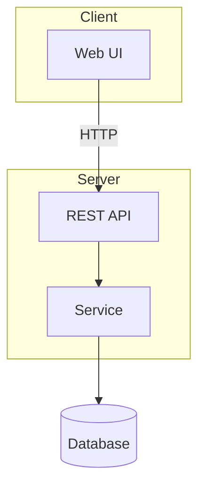
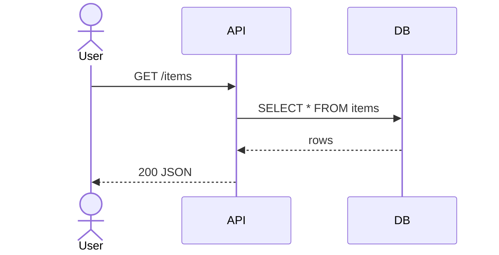
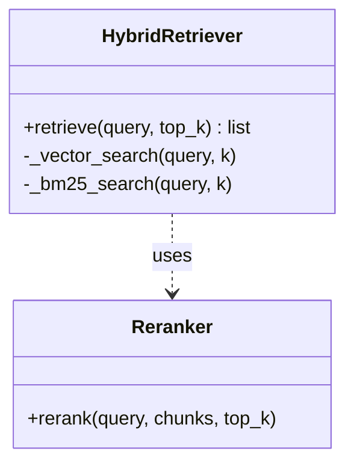
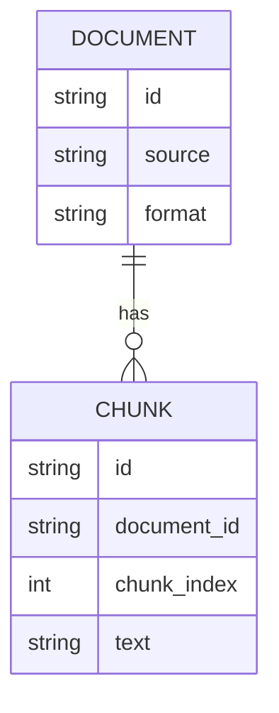
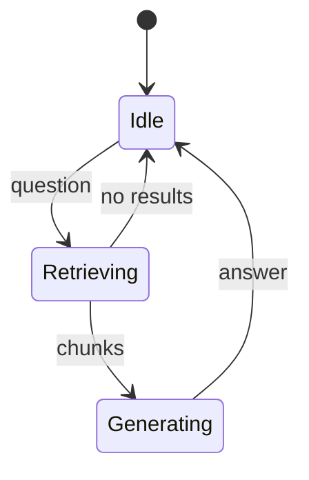
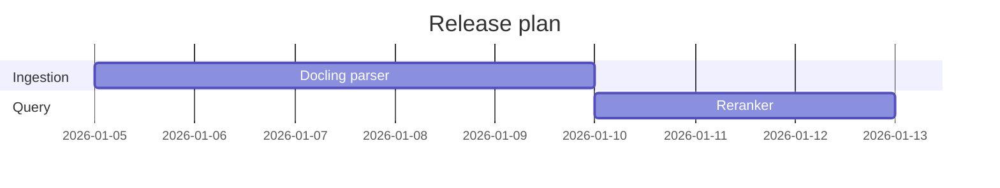
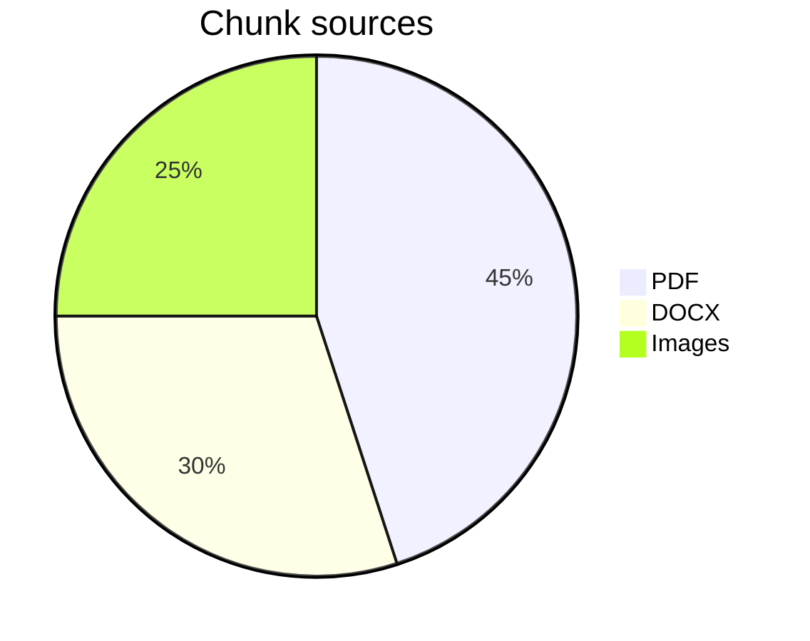
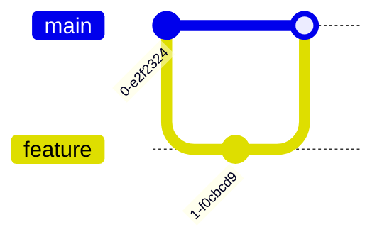
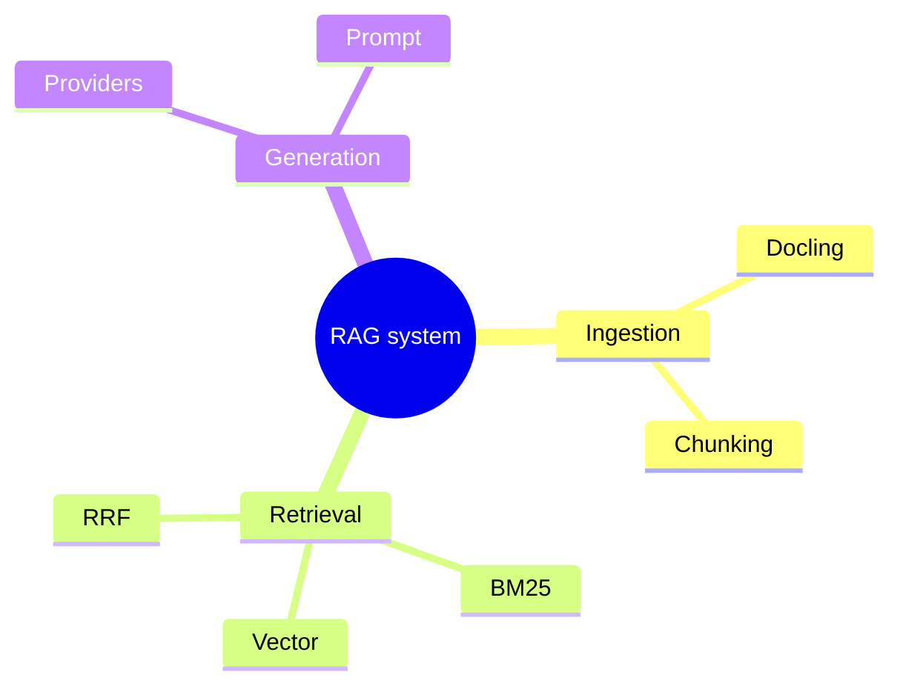
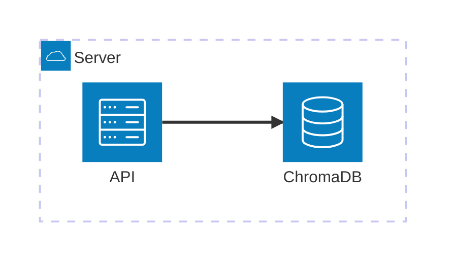

# Choosing a diagram type

Default: **`flowchart TD`** for system architecture, code logic, and data flow.

| You want to show... | Use | First line |
|---|---|---|
| System architecture / components & data flow | flowchart with subgraphs | `flowchart TD` |
| Left-to-right pipeline / CI flow | flowchart LR | `flowchart LR` |
| Interactions between actors over time | sequence diagram | `sequenceDiagram` |
| Code structure: classes, modules, interfaces | class diagram | `classDiagram` |
| Database schema / entities & relations | ER diagram | `erDiagram` |
| State machines, lifecycles | state diagram | `stateDiagram-v2` |
| Project plan / milestones | gantt | `gantt` |
| Proportions / shares | pie | `pie` |
| Roadmap on a timeline | timeline | `timeline` |
| 2x2 prioritization | quadrant chart | `quadrantChart` |
| User journey steps & satisfaction | journey | `journey` |
| Git branch history | git graph | `gitGraph` |
| Concept map | mindmap | `mindmap` |
| Host / network topology (Mermaid ≥ v11.3) | architecture | `architecture-beta` |
| UI layout blocks | block | `block-beta` |
| Packet / protocol fields | packet | `packet-beta` |
| Flow magnitudes (in → out) | sankey | `sankey-beta` |
| Numeric series | xy chart | `xyChart` |
| C4 model (context / container / component) | C4 | `C4Context` |
| Requirements traceability | requirement | `requirementDiagram` |

## Minimal examples (copy-paste starters)

### flowchart (default — architecture & logic)

### sequenceDiagram (interactions over time)

### classDiagram (code structure)

### erDiagram (database schema)

### stateDiagram-v2 (lifecycles)

### gantt (plans)

### pie (shares)

### gitGraph (branch history)

### mindmap (concepts)

### architecture-beta (host topology, Mermaid ≥ v11.3)

For the remaining types (`timeline`, `quadrantChart`, `journey`, `block-beta`, `packet-beta`, `sankey-beta`, `xyChart`, `C4*`, `requirementDiagram`) see the official docs at https://mermaid.js.org — the first-line keyword above is all you need to start.
