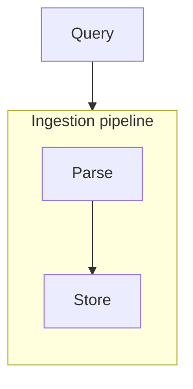
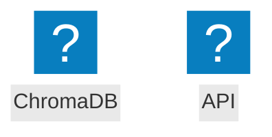

# Flowchart syntax reference (Mermaid)

The flowchart is the default diagram type for this skill. Everything below is valid in Mermaid v10/v11 (icons need v11).

## Nodes

| Shape | Syntax | Typical use |
|---|---|---|
| Rectangle | `A["text"]` | process / component |
| Rounded | `A("text")` | start/end, UI |
| Stadium | `A(["text"])` | terminal |
| Subroutine | `A[["text"]]` | predefined process |
| Cylinder | `A[("text")]` | **data store / database** |
| Circle | `A(("text"))` | connector / event |
| Diamond | `A{"text"}` | decision |
| Hexagon | `A{{"text"}}` | preparation |
| Parallelogram | `A[/"text"/]` | input/output |
| Trapezoid | `A[/"text"\]` | manual operation |
| Asymmetric | `A>"text"]` | flag |

Rules:
- Always quote labels: `A["some text"]`. Unquoted labels break on `( ) [ ] { } : ; / ? & -- >`.
- Node ID: `A` in the examples — `[A-Za-z0-9_]`, unique per file, not a reserved word (`end`, `subgraph`, `direction`, `style`, ...).
- Same ID twice with the same shape = same node (reuse it for edges). Same ID with a different shape = error/warning.

## Edges

| Syntax | Line | Endpoint marker |
|---|---|---|
| `A --> B` | solid | filled triangle (default arrowhead) |
| `A --- B` | solid | none (open link) |
| `A -- text --> B` | solid + label | filled triangle |
| `A -.-> B` / `A -. text .-> B` | dotted (optional/async) | filled triangle |
| `A ==> B` / `A == text ==> B` | thick | thick triangle |
| `A <--> B` | solid | triangles at both ends |
| `A o--o B` | solid | circles |
| `A x--x B` | solid | crosses |
| `A -->|text| B` | solid + pipe label | filled triangle |
| `A --> B & C --> D` | — | chains |

Edge text is free-form after `--` up to the closing arrow; keep it short (a verb phrase).

Arrowheads are SVG `<marker>` elements attached to each edge — the `.mmd` file itself never contains a "?" glyph. If a preview shows a box/"?" at a connection point, that renderer failed to draw the marker (usually an old Mermaid bundled in the preview extension). Verify with https://mermaid.live or an `mmdc` SVG export; updating the VS Code Mermaid Preview extension (or VS Code ≥ 1.121 with built-in Mermaid) fixes it.

Restyle edges: `linkStyle default stroke:#1565C0,stroke-width:2px` applies to all edges; `linkStyle <n> ...` targets the n-th edge in definition order (fragile — prefer `default`). There is no global "remove all arrowheads" config — use `---` per edge for a headless look.

## Subgraphs (grouping layers / services / boundaries)



- `subgraph ID["Title"]` … `end`. Every subgraph needs its `end`.
- `direction TB|BT|LR|RL` at top level or inside a subgraph.
- Edges can point at a subgraph ID (renders an edge to the group box).
- Nesting subgraphs is allowed; keep ≤ 2 levels.

## Styling

```mermaid
flowchart TD
    A["x"]:::myClass
    B["y"]:::myClass
    classDef myClass fill:#E3F2FD,stroke:#1565C0,color:#212121,stroke-width:2px
    class A,B otherClass        %% class statement alternative
    style A fill:#f9f,stroke:#333 %% per-node (prefer classDef)
```

- Colors: `#RRGGBB`. Keep light fill + dark text, or white text on dark fill.
- `linkStyle <index> stroke:#999,stroke-dasharray:5 5` is index-based and fragile — prefer classes.

## Icons & node metadata (Mermaid ≥ v11)



- Icon names are Iconify-style: `fa:database` (solid), `fab:docker` (brands), etc.
- **Icons are fetched at render time** — Mermaid ≥ v11 loads icon packs from a CDN (Iconify) when the diagram renders. If the fetch fails (offline viewer, sandboxed browser such as `mmdc`'s Chromium, blocked CSP), Mermaid draws a **literal `?` in the icon box** as the fallback glyph.
- Post-render check: `grep -c '>?</tspan>' out.svg` must be `0`. Any hit = an icon didn't resolve.
- Guidance: use `@{ icon }` only when you can verify the target renderer loads the pack (e.g. mermaid.live online, VS Code preview with network). For repo-committed SVGs or offline viewing, **skip icons** and rely on shapes + `classDef` colors — identical result in every renderer.
- If the renderer is older than v11, `@{...}` isn't supported at all — update the preview extension or drop the metadata.

## Escaping & text in labels

- Raw `"` inside a label → use `#quot;`. New line → `<br/>`. Other HTML entities work: `#9829;` (♠), etc.
- Avoid emoji — use `@{ icon }` instead.
- Long labels: wrap with `<br/>`; move detail to a `%%` comment.

## Config at the top of the file

Directive form (works everywhere):

```mermaid
%%{init: {'theme': 'base', 'flowchart': {'curve': 'basis'}}}%%
flowchart TD
```

YAML frontmatter (Mermaid ≥ v11):

```mermaid
---
config:
  theme: dark
---
flowchart TD
```

For ready-made presentation presets (dark theme, brand palette, hand-drawn look) and export formats, see [styling-themes.md](styling-themes.md).

## Comments

`%% anything` — to end of line. Not inside a quoted label.
**Never leave a bare `%%` line** (nothing after `%%`) — Mermaid v11 fails to parse it. Always write `%% text`.
